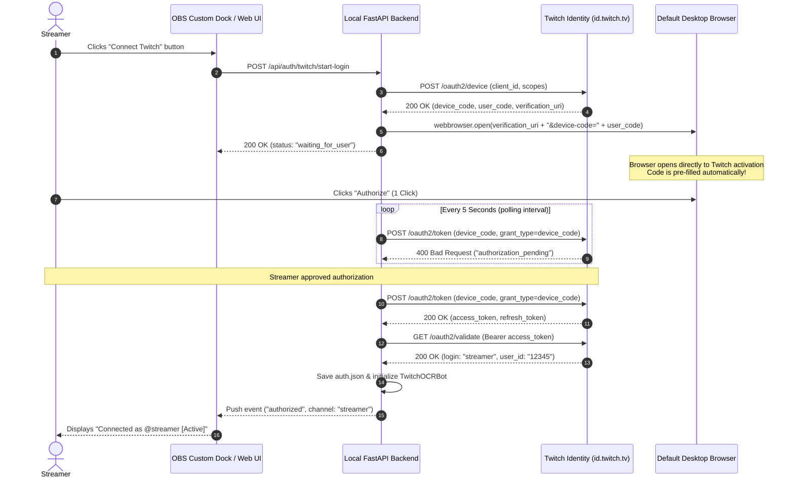

# 1-Click Twitch OAuth Integration for Desktop & OBS Applications

## Executive Summary

This research establishes the optimal authentication architecture for the commercial release of the Twitch OCR Chatbot companion application (OBS Dock and standalone Windows desktop executable).

Streamers must never be required to register developer applications, manage credentials in the Twitch Developer Console, or copy-paste token strings into `.env` files. The integration must function as a seamless "1-Click Connect" experience that securely persists authorization across restarts and updates without recurring cloud server hosting costs.

Based on official Twitch Developer API specifications and OAuth 2.0 RFC standards, **Twitch does not support Proof Key for Code Exchange (PKCE)** for Authorization Code flow. Consequently, standard Authorization Code flow requires a `client_secret` that cannot be securely distributed in a desktop binary. 

The officially supported, architecturally sound solution is **Twitch Device Code Grant Flow (RFC 8628) configured with a "Public" Client Type**, supplemented by deep-link URI auto-population (`https://www.twitch.tv/activate?public=true&device-code=<USER_CODE>`). This achieves:
1. **True 1-Click Streamer Authorization** in their default desktop browser without typing codes.
2. **Zero Client Secret Exposure** (client secret is neither generated nor required).
3. **Long-term Silent Token Refresh** via rolling refresh tokens (30-day inactivity window).
4. **Zero Local Port Conflicts or Firewall Popups** by eliminating the need for an inbound HTTP loopback listener.

---

## 1. OAuth Flow Evaluation for Distributed Desktop Clients

Distributed desktop applications (Windows executables) are classified under [RFC 6749 Section 2.1](https://datatracker.ietf.org/doc/html/rfc6749#section-2.1) as **Public Clients** because they execute entirely on end-user hardware where client secrets cannot be kept confidential against reverse engineering, memory inspection, or decompilation.

### Comparative Analysis of Candidate Flows

| Dimension | Authorization Code with PKCE | Standard Authorization Code | Implicit Grant Flow | Device Code Grant Flow (DCF) |
| :--- | :--- | :--- | :--- | :--- |
| **Twitch Support Status** | **Unsupported** by Twitch | Supported (requires secret) | Supported | **Supported natively** |
| **Client Secret Required?** | No (by RFC 7636 spec) | **Yes** (`client_secret` mandatory) | No | **No** (with Public Client Type) |
| **Refresh Token Issued?** | Yes | Yes | **No** (Access token only) | **Yes** (Rolling refresh token) |
| **Access Token Lifetime** | ~4 hours | ~4 hours | ~4 hours | ~4 hours |
| **Streamer Maintenance** | Single initial login | Single initial login | **Must re-login every 4 hours** | **Single initial login** (auto-refreshing) |
| **Local Inbound Port Needed?** | Yes (loopback redirect) | Yes (loopback redirect) | Yes (loopback redirect) | **No** (outbound HTTP only) |
| **Cloud Proxy Required?** | No | Yes (to protect secret) | No | **No** |
| **Security Compliance** | N/A (unsupported) | Leaks secret if in binary | Token exposed in browser URL hash | RFC 8628 compliant |

### Flow 1: Authorization Code Flow with PKCE (RFC 7636)
- **Status:** **Not Supported by Twitch.**
- **Details:** RFC 7636 (Proof Key for Code Exchange) is the industry standard for securing OAuth 2.0 public clients without a client secret. However, the Twitch authorization server (`https://id.twitch.tv/oauth2/authorize` and `https://id.twitch.tv/oauth2/token`) does not support PKCE parameters (`code_challenge`, `code_challenge_method`, and `code_verifier`).
- **Primary Source:** [Twitch Developers Forum & Docs Tracker](https://discuss.dev.twitch.com/t/pkce-support-for-oauth/22814). Twitch's token exchange endpoint explicitly requires the `client_secret` field when `grant_type=authorization_code`.

### Flow 2: Standard Authorization Code Flow
- **Primary Source:** [Twitch Docs: Authorization Code Grant Flow](https://dev.twitch.tv/docs/authentication/getting-tokens-oauth/#authorization-code-grant-flow).
- **Mechanism:** The client redirects the user to Twitch, receives a short-lived `code` on a local redirect URI, and issues `POST https://id.twitch.tv/oauth2/token` containing `client_id`, `client_secret`, `code`, and `grant_type=authorization_code`.
- **Fatal Flaw for Desktop App:** Twitch documentation states:
  > *"IMPORTANT: Treat client secrets as you would your password. You must keep it confidential and never expose it to users, even in an obscured form."*
  > *"WARNING: Do not share client IDs among applications... Sharing client IDs among applications may result in the suspension of your application’s access to the Twitch API."* ([Twitch Docs: Register App](https://dev.twitch.tv/docs/authentication/register-app/))
- Embedding a shared `client_secret` inside a packaged Windows binary (PyInstaller/Python) allows any user or malicious actor to extract it via disassemblers (e.g., `pycdc`) or network sniffing, enabling API impersonation and risking immediate global revocation of the developer's client credentials.

### Flow 3: Implicit Grant Flow (`response_type=token`)
- **Primary Source:** [Twitch Docs: Implicit Grant Flow](https://dev.twitch.tv/docs/authentication/getting-tokens-oauth/#implicit-grant-flow).
- **Mechanism:** The user's browser opens `https://id.twitch.tv/oauth2/authorize?response_type=token&client_id=...&redirect_uri=...`. Upon approval, Twitch redirects to `http://localhost:8000/api/auth/twitch/callback#access_token=...&token_type=bearer`.
- **Fatal Flaw for Desktop App:** **No refresh tokens are ever issued.**
  > *"Because there is no refresh token, once an access token obtained via the implicit grant flow expires, the application must redirect the user back to the Twitch authorization endpoint to obtain a new token."* ([Twitch Docs: Getting OAuth Tokens](https://dev.twitch.tv/docs/authentication/getting-tokens-oauth/#implicit-grant-flow))
- Because Twitch user access tokens expire after approximately **4 hours**, streamers would be forced to re-authenticate every streaming session or mid-stream. Silent re-authorization within an embedded iframe is rejected by Twitch's HTTP headers (`X-Frame-Options: DENY`).

### Flow 4: Device Code Grant Flow (DCF / RFC 8628) with Public Client Type
- **Primary Source:** [Twitch Docs: Device Code Grant Flow](https://dev.twitch.tv/docs/authentication/getting-tokens-oauth/#device-code-grant-flow) and [Twitch Docs: Refreshing Access Tokens](https://dev.twitch.tv/docs/authentication/refresh-tokens/).
- **Official Twitch Recommendation for Open Clients:** Twitch documentation explicitly establishes:
  > *"Device Code Grant Flow (DCF) allows for public and confidential client types. The major differences between a public and confidential client type is that public clients:*
  > *- Do not need to maintain a client secret.*
  > *- Can refresh an access token without passing a client secret.*
  > *- Are only limited to the usage of device authorization grant flow to obtain OAuth tokens...*
  > *Generally, if your device is secure, then confidential is the client type you should use, however if your application is on a more open platform (such as windows) we suggest using public."* ([Twitch Docs: Getting Tokens](https://dev.twitch.tv/docs/authentication/getting-tokens-oauth/#device-code-grant-flow))
- **Why DCF Solves 1-Click for Desktop & OBS:**
  1. The client registers as **Client Type: Public** in the Twitch Developer Console (no client secret generated or required).
  2. The application requests a device code: `POST https://id.twitch.tv/oauth2/device`.
  3. Twitch returns `user_code` and `verification_uri`: `https://www.twitch.tv/activate?public=true&device-code=<USER_CODE>`.
  4. The desktop app launches this exact verification URI in the streamer's default browser via `webbrowser.open()`.
  5. Because the `device-code` query parameter is embedded in the URL, **Twitch automatically pre-fills the activation code in the browser UI**. The streamer does not type or paste anything.
  6. The streamer clicks **"Authorize"** once in their browser.
  7. The app's background polling loop receives both an `access_token` and a rolling `refresh_token`.
  8. Subsequent token refreshes require only `client_id` and `refresh_token`—**no client secret is required**.

---

## 2. Local Loopback Redirect URI: Rules, Limitations & Mechanics

If an application chooses to use a redirect-based grant flow (such as Implicit Grant or an Auth Code proxy), Twitch enforces strict redirect URI rules that differ significantly from other identity providers.

### Twitch Redirect URI Registration Rules
1. **Strict Exact String Matching:**
   - Twitch documentation and authorization servers enforce exact, byte-for-byte matching between the URI registered in the Twitch Developer Console and the `redirect_uri` parameter in the request.
   - Any discrepancy in protocol, port, path, or trailing slashes triggers an immediate rejection: `400 Bad Request: Parameter redirect_uri does not match registered URI` ([Twitch Docs: Register App](https://dev.twitch.tv/docs/authentication/register-app/)).
2. **No Wildcard Ports / No Dynamic Port Binding:**
   - Unlike Google OAuth ([RFC 8252 Section 7.3](https://datatracker.ietf.org/doc/html/rfc8252#section-7.3)) which permits dynamic port binding for native apps on `http://127.0.0.1:<random-port>`, **Twitch does not support wildcard ports** (e.g. `http://localhost:*` is rejected).
   - The port must be explicitly hardcoded and registered in the console (e.g., `http://localhost:8000/api/auth/twitch/callback`).
3. **`localhost` vs `127.0.0.1` Separation:**
   - Twitch treats `localhost` and `127.0.0.1` as distinct origins. Registering `http://localhost:8000/...` will fail if the client passes `http://127.0.0.1:8000/...`.
   - *Best Practice:* In the Twitch Developer Console, register both:
     - `http://localhost:8000/api/auth/twitch/callback`
     - `http://127.0.0.1:8000/api/auth/twitch/callback`
4. **Multiple Redirect URIs Supported:**
   - Twitch allows up to 10 redirect URIs per application in the Developer Console. This can be used to register alternative fallback ports (e.g. `8000`, `8080`, `8081`).

### The URI Fragment Problem (Implicit Flow on Loopback)
In the Implicit Grant flow, Twitch delivers the access token within the URI fragment:
```
http://localhost:8000/api/auth/twitch/callback#access_token=abcdef123456&scope=chat%3Aread...
```
- **The Challenge:** Per RFC 3986, web browsers **do not send URI fragments** in HTTP request headers. When the browser navigates to `http://localhost:8000/api/auth/twitch/callback`, the local server receives a plain `GET /api/auth/twitch/callback` without the access token.
- **The Trampoline Solution:** The local FastAPI endpoint must return a client-side JavaScript landing page that reads `window.location.hash` and POSTs the extracted token back to the local backend:
```html
<!DOCTYPE html>
<html>
<head><title>Twitch Authorization</title></head>
<body>
  <h3>Authorizing with Twitch OCR Companion...</h3>
  <script>
    const hash = window.location.hash.substring(1);
    const params = new URLSearchParams(hash);
    const accessToken = params.get('access_token');
    const state = params.get('state');
    const error = params.get('error');

    if (accessToken) {
      fetch('/api/auth/twitch/receive-token', {
        method: 'POST',
        headers: {'Content-Type': 'application/json'},
        body: JSON.stringify({access_token: accessToken, state: state})
      })
      .then(res => res.json())
      .then(() => {
        document.body.innerHTML = '<h3>Connected successfully! You can close this window.</h3>';
        setTimeout(() => window.close(), 1500);
      });
    } else {
      document.body.innerHTML = '<h3>Authorization failed: ' + (error || 'Unknown error') + '</h3>';
    }
  </script>
</body>
</html>
```

### Inherent Desktop Vulnerabilities with Loopback Listeners
1. **Port Collisions:** If port `8000` is already in use by another local development server or application on the streamer's PC, the companion app cannot bind to the port. Because Twitch disallows dynamic ports, the authentication flow halts unless the user manually intervenes.
2. **Windows Defender Firewall Prompts:** Opening a new listening socket on Windows often triggers an intrusive "Windows Security Alert - Allow Python to communicate on private networks" dialogue that degrades commercial user experience.
3. **Contrast with Device Code Flow:** Device Code Flow uses only **outbound HTTPS requests** to `id.twitch.tv`. It requires zero listening sockets, zero port reservations, zero firewall exceptions, and zero URI fragment extraction scripts.

---

## 3. Required Scopes for Reading and Sending Twitch Chat

Twitch supports two chat communication protocols: **IRC (Internet Relay Chat)** and the **Helix REST API / EventSub**. The application currently uses `twitchio.ext.commands.Bot` over IRC and is transitioning toward hybrid Helix/EventSub capabilities.

### Detailed Scope Breakdown

| Scope Name | Protocol | Purpose | Primary Documentation Reference |
| :--- | :--- | :--- | :--- |
| `chat:read` | Twitch IRC | Allows viewing and receiving chat messages sent in a channel via an IRC connection (`PRIVMSG`). | [Twitch Docs: Scopes (IRC)](https://dev.twitch.tv/docs/authentication/scopes/#irc-chat-scopes) |
| `chat:edit` | Twitch IRC | Allows sending chat messages to a channel chatroom using an IRC connection (`PRIVMSG`). | [Twitch Docs: Scopes (IRC)](https://dev.twitch.tv/docs/authentication/scopes/#irc-chat-scopes) |
| `user:read:chat` | Helix / EventSub | Allows receiving chatroom messages and notifications via EventSub topic `channel.chat.message`. | [Twitch Docs: Scopes](https://dev.twitch.tv/docs/authentication/scopes/) & [EventSub](https://dev.twitch.tv/docs/eventsub/eventsub-subscription-types/#channelchatmessage) |
| `user:write:chat` | Helix REST API | Allows sending chat messages to a channel chatroom via `POST https://api.twitch.tv/helix/chat/messages`. | [Twitch Docs: Send Chat Message](https://dev.twitch.tv/docs/api/reference/#send-chat-message) |

### Context on App Access Token Scopes (`user:bot` & `channel:bot`)
- Twitch introduced `user:bot` and `channel:bot` for centralized multi-tenant cloud chatbots that send messages on behalf of a separate bot account using App Access Tokens ([Twitch Docs: Chatbot Verification](https://dev.twitch.tv/docs/chat/)).
- **Not Applicable Here:** For a self-hosted streamer companion where the broadcaster directly authorizes their own account to monitor and post in their own channel, a standard **User Access Token** is used. Only `user:read:chat` and `user:write:chat` (or `chat:read` and `chat:edit`) are required.

### Recommended Production Scope String
To support immediate IRC operations (`twitchio`) and future-proof the application for Helix REST chat APIs without requiring a second authorization consent prompt:
```text
chat:read chat:edit user:read:chat user:write:chat
```
When URL-encoded for authorization requests:
```text
chat%3Aread+chat%3Aedit+user%3Aread%3Achat+user%3Awrite%3Achat
```

---

## 4. Local Token Lifecycle, Validation, Persistence & Refresh

To ensure the streamer logs in **exactly once** and never touches authentication settings again, the application must manage a local token lifecycle engine adhering to Twitch developer guidelines.

### Phase 1: Streamer Identity Discovery via Token Validation
Immediately upon receiving a token, the application must query the Twitch token validation endpoint.
- **Endpoint:** `GET https://id.twitch.tv/oauth2/validate`
- **Header:** `Authorization: OAuth <access_token>` or `Authorization: Bearer <access_token>`
- **Primary Source:** [Twitch Docs: Validating Tokens](https://dev.twitch.tv/docs/authentication/validate-tokens/)

#### Validation Response Payload
```json
{
  "client_id": "hof5gwx0su6owfnys0yan9c87zr6t",
  "login": "streamer_channel_name",
  "scopes": [
    "chat:read",
    "chat:edit",
    "user:read:chat",
    "user:write:chat"
  ],
  "user_id": "141981764",
  "expires_in": 14388
}
```

#### Key Automation Benefits
1. **Zero-Config Channel Detection:** The `login` field returns the lowercase Twitch username of the broadcaster. The app automatically assigns this to `Config.TWITCH_CHANNEL` and bot nick. The user does not even need to type their channel name.
2. **User ID Caching:** The `user_id` is cached locally, which is required for Helix API calls (e.g. `broadcaster_id` and `sender_id`).

### Phase 2: Mandatory Hourly Validation Requirement
Twitch Developer Documentation explicitly mandates periodic token verification:
> *"Any third-party app that calls the Twitch APIs and maintains an OAuth session must call the `/validate` endpoint to verify that the access token is still valid. This includes web apps, mobile apps, desktop apps, extensions, and chatbots. Your app must validate the OAuth token when it starts and on an hourly basis thereafter.*
> *Twitch periodically conducts audits to discover applications that are not validating access tokens hourly as required."* ([Twitch Docs: Validating Tokens](https://dev.twitch.tv/docs/authentication/validate-tokens/#who-must-validate-tokens))

#### Implementation Strategy
An asynchronous background task in FastAPI (`asyncio.create_task`) runs every 60 minutes:
```python
async def token_validation_watchdog():
    while True:
        await asyncio.sleep(3600)  # Hourly check
        try:
            status = await validate_twitch_token()
            if status["expires_in"] < 1800:  # Less than 30 mins remaining
                await refresh_twitch_token()
        except TokenInvalidException:
            # Token revoked or expired; trigger proactive refresh
            await refresh_twitch_token()
```

### Phase 3: Silent Refresh Token Mechanics (Public Client)
When the access token reaches expiration (~4 hours) or the validation endpoint returns HTTP 401, the application reactively refreshes the token without user intervention.

- **Endpoint:** `POST https://id.twitch.tv/oauth2/token`
- **Headers:** `Content-Type: application/x-www-form-urlencoded`
- **Form Body:**
  ```text
  grant_type=refresh_token&refresh_token=<URL_ENCODED_REFRESH_TOKEN>&client_id=<CLIENT_ID>
  ```
  *(Note: For Public clients, `client_secret` is omitted).*
- **Primary Source:** [Twitch Docs: Refreshing Access Tokens](https://dev.twitch.tv/docs/authentication/refresh-tokens/#how-to-use-a-refresh-token)

#### Critical Twitch Refresh Token Rules
1. **URL Encoding Mandatory:** The refresh token string may contain reserved characters (such as `/`, `+`, `=`). It must be URL-encoded in the POST body (`urllib.parse.quote(refresh_token)`), or Twitch returns `400 Bad Request: Invalid refresh token`.
2. **Single-Use Rolling Tokens:** Refresh tokens issued to Public clients are single-use. Each successful refresh returns a brand new `access_token` and a brand new `refresh_token`. The old refresh token is immediately invalidated. The app must persist the new pair atomically to disk.
3. **30-Day Rolling Inactivity Window:**
   > *"Most refresh tokens do not expire, but refresh tokens generated by a Public client type will expire 30 days after they are generated... If your application is on a more open platform (such as windows) we suggest using public."* ([Twitch Docs: Refresh Tokens](https://dev.twitch.tv/docs/authentication/refresh-tokens/#can-a-refresh-token-become-invalid))
   As long as the streamer opens the companion app at least once every 30 days, the token refreshes and rolls forward indefinitely.

### Phase 4: Local Secure Persistence
To eliminate `.env` file editing by non-technical users, credentials must be stored locally in a dedicated application storage file.

#### Recommended Storage Location
On Windows, store credentials in the user profile directory:
`%APPDATA%\TwitchOCRChatbot\auth.json` (or `.auth.json` in the local app directory for portable mode).

#### Data Schema (`auth.json`)
```json
{
  "client_id": "hof5gwx0su6owfnys0yan9c87zr6t",
  "access_token": "oauth:abcdef123456...",
  "refresh_token": "eyJfMzUtNDU0OC4MWYwLTQ5MDY5ODY4NGNlMSJ9...",
  "expires_at": 1728514800,
  "user_id": "141981764",
  "login": "streamer_channel",
  "updated_at": "2026-10-09T16:30:00Z"
}
```

#### Optional Windows DPAPI Encryption
For commercial-grade security on Windows desktop distributions, token strings can be encrypted at rest using Windows Data Protection API (DPAPI) via the native Windows `CryptProtectData` API (available via standard `ctypes` or `pywin32`):
- Encryption key is derived transparently from the user's logged-in Windows user account.
- Other Windows user accounts or outside machines cannot decrypt the token file.

---

## 5. End-to-End Recommended Architecture: The 1-Click Device Code Flow

Below is the concrete end-to-end flow diagram and implementation blueprint for the companion app.



### Key Python Implementation Snippet

```python
import urllib.parse
import urllib.request
import json
import webbrowser
import asyncio
from pathlib import Path

CLIENT_ID = "YOUR_REGISTERED_PUBLIC_CLIENT_ID"
SCOPES = "chat:read chat:edit user:read:chat user:write:chat"
AUTH_FILE = Path.home() / "AppData" / "Roaming" / "TwitchOCRChatbot" / "auth.json"

async def initiate_1click_twitch_login():
    """Step 1: Request Device Code from Twitch and open pre-filled browser."""
    data = urllib.parse.urlencode({
        "client_id": CLIENT_ID,
        "scopes": SCOPES
    }).encode("utf-8")
    
    req = urllib.request.Request(
        "https://id.twitch.tv/oauth2/device",
        data=data,
        headers={"Content-Type": "application/x-www-form-urlencoded"}
    )
    
    with urllib.request.urlopen(req, timeout=10) as resp:
        res = json.loads(resp.read().decode("utf-8"))
        
    device_code = res["device_code"]
    user_code = res["user_code"]
    interval = res.get("interval", 5)
    verification_uri = res["verification_uri"]  # Includes pre-filled device-code
    
    # Open default browser for true 1-click authorization
    webbrowser.open(verification_uri)
    
    # Start polling loop
    return await poll_for_authorization(device_code, interval)

async def poll_for_authorization(device_code: str, interval: int = 5):
    """Step 2: Poll Twitch token endpoint until user clicks Authorize."""
    poll_data = urllib.parse.urlencode({
        "client_id": CLIENT_ID,
        "scopes": SCOPES,
        "device_code": device_code,
        "grant_type": "urn:ietf:params:oauth:grant-type:device_code"
    }).encode("utf-8")
    
    while True:
        await asyncio.sleep(interval)
        try:
            req = urllib.request.Request(
                "https://id.twitch.tv/oauth2/token",
                data=poll_data,
                headers={"Content-Type": "application/x-www-form-urlencoded"}
            )
            with urllib.request.urlopen(req, timeout=10) as resp:
                token_res = json.loads(resp.read().decode("utf-8"))
                
                access_token = token_res["access_token"]
                refresh_token = token_res["refresh_token"]
                
                # Step 3: Validate and discover streamer identity
                user_info = await validate_token(access_token)
                
                # Step 4: Persist locally
                save_credentials({
                    "client_id": CLIENT_ID,
                    "access_token": f"oauth:{access_token}",
                    "refresh_token": refresh_token,
                    "login": user_info["login"],
                    "user_id": user_info["user_id"]
                })
                return user_info
        except urllib.error.HTTPError as e:
            err = json.loads(e.read().decode("utf-8"))
            if err.get("message") == "authorization_pending":
                continue
            raise RuntimeError(f"Twitch OAuth Error: {err}")

async def refresh_access_token(stored_refresh_token: str):
    """Step 5: Silent token refresh without client secret (Public Client)."""
    refresh_data = urllib.parse.urlencode({
        "grant_type": "refresh_token",
        "refresh_token": stored_refresh_token,
        "client_id": CLIENT_ID
    }).encode("utf-8")
    
    req = urllib.request.Request(
        "https://id.twitch.tv/oauth2/token",
        data=refresh_data,
        headers={"Content-Type": "application/x-www-form-urlencoded"}
    )
    with urllib.request.urlopen(req, timeout=10) as resp:
        new_tokens = json.loads(resp.read().decode("utf-8"))
        # Immediately update storage with rolling refresh token
        update_stored_tokens(new_tokens["access_token"], new_tokens["refresh_token"])
        return new_tokens["access_token"]
```

---

## 6. Primary Sources & Documentation Citations

1. **Twitch Getting OAuth Access Tokens:**
   https://dev.twitch.tv/docs/authentication/getting-tokens-oauth/
   *Details Implicit Grant, Authorization Code Grant, and Device Code Grant flows.*
2. **Twitch Refreshing Access Tokens:**
   https://dev.twitch.tv/docs/authentication/refresh-tokens/
   *Establishes refresh rules, public client secret exemption, single-use rolling tokens, and 30-day expiration.*
3. **Twitch Validating Tokens:**
   https://dev.twitch.tv/docs/authentication/validate-tokens/
   *Defines mandatory hourly validation, auditor compliance, and streamer metadata resolution (`login`, `user_id`).*
4. **Twitch Register Your App:**
   https://dev.twitch.tv/docs/authentication/register-app/
   *Covers Client ID public nature, client secret confidentiality rules, and Public vs Confidential application types.*
5. **Twitch Scopes Reference:**
   https://dev.twitch.tv/docs/authentication/scopes/
   *Defines IRC scopes (`chat:read`, `chat:edit`) and Helix scopes (`user:read:chat`, `user:write:chat`).*
6. **Twitch Send Chat Message API Reference:**
   https://dev.twitch.tv/docs/api/reference/#send-chat-message
   *Helix chat message specification and scope requirements.*
7. **RFC 8628 (OAuth 2.0 Device Authorization Grant):**
   https://datatracker.ietf.org/doc/html/rfc8628
   *IETF standard governing device code generation, verification URIs, and token polling.*
8. **RFC 6749 (The OAuth 2.0 Authorization Framework):**
   https://datatracker.ietf.org/doc/html/rfc6749#section-2.1
   *Classification of native desktop applications as Public Clients.*
9. **RFC 7636 (Proof Key for Code Exchange by OAuth Public Clients):**
   https://datatracker.ietf.org/doc/html/rfc7636
   *Specification for PKCE (not implemented on Twitch identity platform).*
